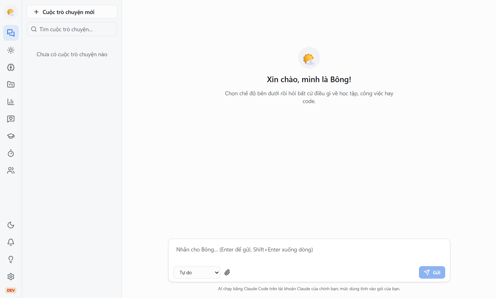
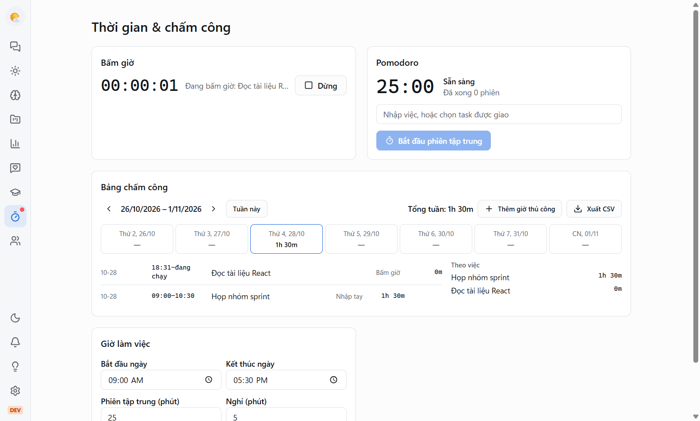
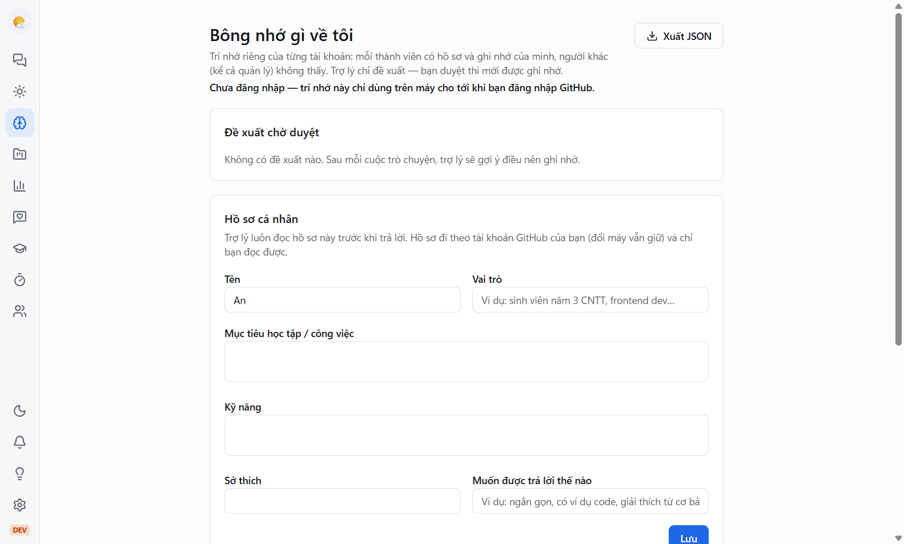
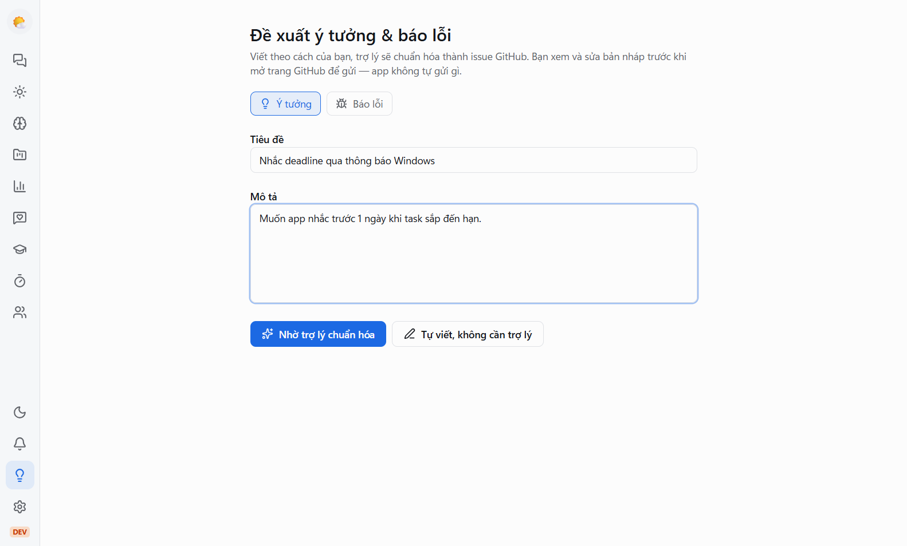
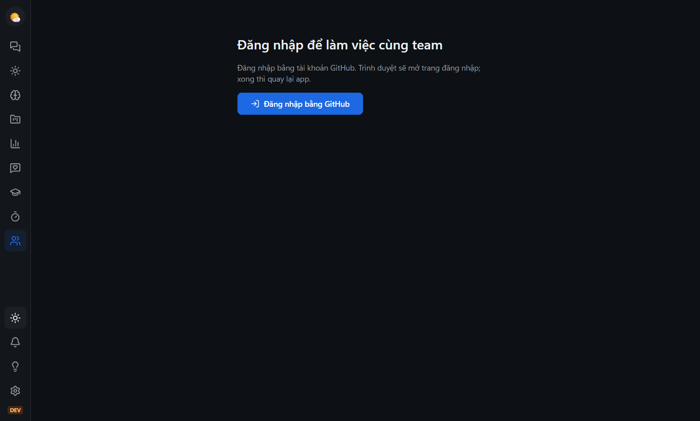

# Team Working

Trợ lý AI trên máy tính (Windows) cho học tập, làm việc nhóm, giao việc, feedback và quản lý thời gian. Trợ lý chạy bằng **Claude Code trên tài khoản Claude của chính bạn**; dữ liệu team được đồng bộ qua máy chủ chung của nhóm.

[**⬇ Tải bản mới nhất**](https://github.com/phanduongthien/team-working/releases/latest) · [Lịch sử thay đổi](CHANGELOG.md) · [Đóng góp code](CONTRIBUTING.md)



## Có gì trong app

- **Trò chuyện với trợ lý**: chế độ Tự do, Học tập, Code, Quản lý dự án; đính kèm ảnh, PDF, file code. Bạn tự đặt tên, avatar, tính cách cho trợ lý.
- **Trí nhớ riêng**: hồ sơ, mục tiêu, sở thích của bạn — đi theo tài khoản GitHub, người khác (kể cả quản lý) không xem được. Trợ lý chỉ *đề xuất* điều nên nhớ, bạn duyệt thì mới lưu.
- **Dự án & task**: Kanban, lịch, bình luận, file đính kèm; trợ lý gợi ý chia việc và phân công, quản lý duyệt trước khi tạo. Dashboard tiến độ, thông báo Windows.
- **Feedback**: góp ý công khai hoặc ẩn danh, feedback cho từng người, đánh giá định kỳ; trợ lý giúp viết cho mang tính xây dựng.
- **Học tập**: lộ trình theo mục tiêu, quiz, flashcard, theo dõi tiến độ.
- **Hôm nay & Thời gian**: kế hoạch ngày, báo cáo cuối ngày/tuần, bấm giờ, Pomodoro, bảng chấm công, xuất CSV (dùng được khi offline).
- **Chế độ Code**: trợ lý đọc thư mục dự án; mỗi thay đổi file đều hiện diff để bạn đồng ý hoặc từ chối.
- **Góp ý & báo lỗi** ngay trong app, tự cập nhật khi có bản mới, chế độ sáng/tối.

| Thời gian & chấm công | Trí nhớ riêng |
|---|---|
|  |  |
| **Góp ý & báo lỗi** | **Chế độ tối** |
|  |  |

## Cài đặt cho thành viên

Cần: Windows 10/11, tài khoản **Claude** (gói Pro hoặc Max) và tài khoản **GitHub**.

### 1. Cài Claude Code và đăng nhập bằng tài khoản Claude của bạn

Mở **PowerShell** (không cần quyền Administrator) và chạy:

```powershell
irm https://claude.ai/install.ps1 | iex
```

Đóng PowerShell, mở lại, gõ `claude` rồi làm theo hướng dẫn để đăng nhập. Xong thì gõ `/exit` để thoát.

> Mỗi người dùng **tài khoản Claude của chính mình** — đừng chia sẻ hay mượn tài khoản. App không đọc, không lưu và không gửi thông tin đăng nhập Claude của bạn đi đâu; mức sử dụng AI tính vào gói của bạn. Hướng dẫn chính thức: <https://code.claude.com/docs/en/setup>.

### 2. Tải và cài Team Working

1. Vào [**Releases → bản mới nhất**](https://github.com/phanduongthien/team-working/releases/latest), tải file `team-working-x.y.z-setup.exe` (trong mục *Assets*).
2. Mở file vừa tải. Vì app **chưa được ký số**, Windows SmartScreen sẽ hiện *"Windows protected your PC"*: bấm **More info → Run anyway** (Thông tin thêm → Vẫn chạy).
3. Làm theo trình cài đặt. Lần đầu mở app, màn hình **Kết nối Claude Code** sẽ kiểm tra bước 1 — nếu báo xanh là xong.

Từ đó về sau app **tự cập nhật**: khi có bản mới, app tải ngầm và hiện thông báo *"Có bản mới — khởi động lại để cập nhật"*.

### 3. Đăng nhập GitHub và vào team

1. Bấm biểu tượng **Team** ở thanh bên → **Đăng nhập bằng GitHub**. Trình duyệt mở trang đăng nhập; đồng ý xong thì quay lại app.
2. Ở mục **Tham gia bằng mã mời**, nhập **mã mời** mà quản lý/trưởng nhóm gửi cho bạn → **Tham gia**. Mã chia sẻ có hiệu lực 7 ngày; nếu được mời qua email, lời mời sẽ hiện sẵn để bấm tham gia.
3. Vào **Team → Hồ sơ của tôi** khai báo tên hiển thị và kỹ năng để trợ lý gợi ý phân công hợp lý.

Trưởng nhóm tạo team ở cùng màn hình (**Tạo team mới**), rồi tạo lời mời ở mục **Lời mời**.

### Gặp vấn đề?

- **Báo "Chưa cài Claude Code" / "Chưa đăng nhập"** dù đã cài: đóng hẳn app rồi mở lại, bấm **Kiểm tra lại**. Vẫn lỗi thì chạy `claude` trong PowerShell để chắc đã đăng nhập.
- **Báo lỗi hoặc đề xuất tính năng**: trong app vào **Cài đặt → Gửi báo lỗi** (tự đính kèm phiên bản và log, đã che thông tin cá nhân), hoặc mở [issue mới](https://github.com/phanduongthien/team-working/issues/new/choose).
- Dữ liệu trên máy nằm ở `%APPDATA%\Team Working\` (log ở thư mục `logs`).

## Đóng góp code

Muốn sửa lỗi hoặc thêm tính năng? Đọc [**CONTRIBUTING.md**](CONTRIBUTING.md) để biết cách chạy dự án, quy tắc commit, cách thêm module và checklist PR. Quy trình phát hành: [docs/release.md](docs/release.md).

Công nghệ: Electron, React, TypeScript, Vite, Tailwind, SQLite (Drizzle), Supabase (Auth, Realtime, RLS), Claude Code CLI.
